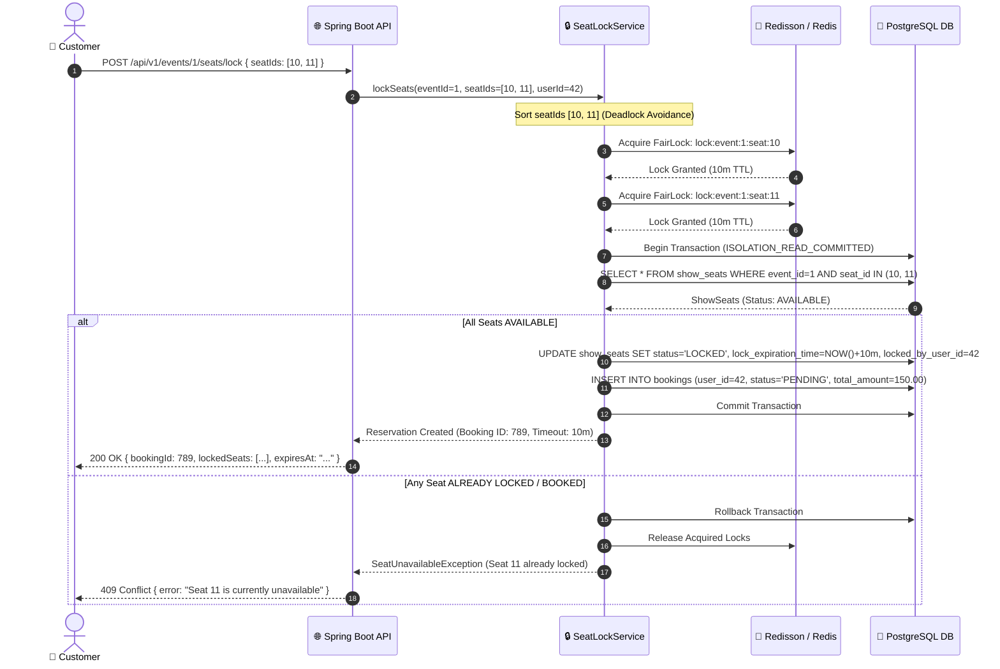
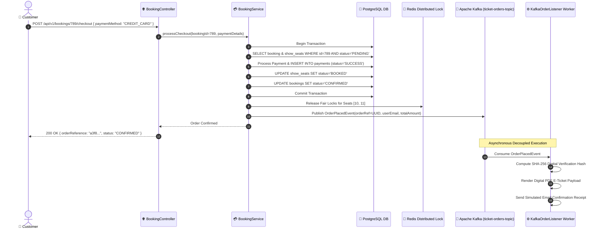
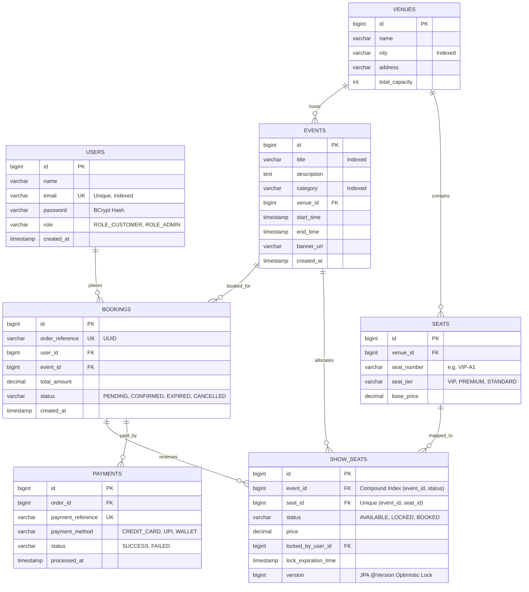

# 🎟️ Distributed Event Ticketing & High-Concurrency Flash Sale Platform

[](https://openjdk.org/)
[](https://spring.io/projects/spring-boot)
[](https://spring.io/projects/spring-security)
[](https://redisson.org/)
[](https://kafka.apache.org/)
[](https://www.postgresql.org/)
[](https://redis.io/)
[](https://react.dev/)
[](https://www.typescriptlang.org/)
[](https://tailwindcss.com/)
[](https://www.docker.com/)
[](https://opensource.org/licenses/MIT)
[](https://github.com/Vikas-kain)

> **An enterprise-grade, distributed event ticketing and flash sale platform engineered to handle massive burst traffic, eliminate double bookings, ensure sub-millisecond catalog reads, and guarantee strictly fair seat allocation under extreme concurrency.**

---

## 📑 Table of Contents

- [1. System Architecture](#1-system-architecture)
  - [1.1 High-Level Architecture Diagram](#11-high-level-architecture-diagram)
  - [1.2 Component Breakdown](#12-component-breakdown)
- [2. Deep-Dive Concurrency & Distributed Engineering](#2-deep-dive-concurrency--distributed-engineering)
  - [2.1 High-Concurrency Distributed Fair Locking](#21-high-concurrency-distributed-fair-locking)
  - [2.2 Two-Tier Race Condition Defense (Redisson + JPA Optimistic Lock)](#22-two-tier-race-condition-defense-redisson--jpa-optimistic-lock)
  - [2.3 Multi-Seat Deadlock Avoidance Algorithm](#23-multi-seat-deadlock-avoidance-algorithm)
  - [2.4 Automated Seat Release & Reconciler Engine](#24-automated-seat-release--reconciler-engine)
  - [2.5 Asynchronous Event-Driven Order Pipeline (Kafka)](#25-asynchronous-event-driven-order-pipeline-kafka)
  - [2.6 High-Throughput Cache-Aside Catalog Strategy](#26-high-throughput-cache-aside-catalog-strategy)
- [3. Sequence & Workflow Diagrams](#3-sequence--workflow-diagrams)
  - [3.1 High-Concurrency Seat Locking Sequence](#31-high-concurrency-seat-locking-sequence)
  - [3.2 Checkout & Kafka Fulfillment Sequence](#32-checkout--kafka-fulfillment-sequence)
- [4. Relational Database Schema & Data Modeling](#4-relational-database-schema--data-modeling)
  - [4.1 Entity-Relationship (ER) Diagram](#41-entity-relationship-er-diagram)
  - [4.2 Database Table Specifications & Indices](#42-database-table-specifications--indices)
- [5. Complete RESTful API Reference](#5-complete-restful-api-reference)
  - [5.1 Authentication Endpoints](#51-authentication-endpoints)
  - [5.2 Public Event Catalog & Seat Map Endpoints](#52-public-event-catalog--seat-map-endpoints)
  - [5.3 Customer Seat Locking & Booking Endpoints](#53-customer-seat-locking--booking-endpoints)
  - [5.4 Admin Management & Analytics Endpoints](#54-admin-management--analytics-endpoints)
- [6. Frontend Experience & Interactive UI](#6-frontend-experience--interactive-ui)
- [7. Repository Structure](#7-repository-structure)
- [8. Deployment & Quick Start Guide](#8-deployment--quick-start-guide)
  - [8.1 Option A: Docker Compose Deployment (Recommended)](#81-option-a-docker-compose-deployment-recommended)
  - [8.2 Option B: Bare-Metal Local Development](#82-option-b-bare-metal-local-development)
  - [8.3 Default Seed Credentials](#83-default-seed-credentials)
- [9. Concurrency & Stress Testing Guide](#9-concurrency--stress-testing-guide)
- [10. Security & Production Hardening](#10-security--production-hardening)
- [11. License & Contributing](#11-license--contributing)

---

## 1. System Architecture

### 1.1 High-Level Architecture Diagram

```
                                  ┌─────────────────────────────────────────────────────────┐
                                  │            React 18 + TypeScript SPA                    │
                                  │  • Vite Build  • Tailwind CSS Dark UI  • Lucide Icons   │
                                  └───────────────────────────┬─────────────────────────────┘
                                                              │ HTTPS / REST (JSON + JWT)
                                                              ▼
                                  ┌─────────────────────────────────────────────────────────┐
                                  │          Spring Boot 3 API Gateway Layer                │
                                  │  • Spring Security 6 (Stateless JWT Filter)             │
                                  │  • CORS Policy • Request Validation • Global Exception  │
                                  └─────────────┬─────────────────────────────┬─────────────┘
                                                │                             │
                        ┌───────────────────────┘                             └────────────────────────┐
                        ▼                                                                              ▼
         ┌──────────────────────────────┐                                              ┌──────────────────────────────┐
         │     SeatLockService          │                                              │    Event Catalog Service     │
         │  • Redisson Fair Locks       │                                              │  • Redis Cache-Aside Engine  │
         │  • 10-Minute Hold Window     │                                              │  • Sub-millisecond Reads     │
         │  • Contention 409 Resolution │                                              │  • @Cacheable & @CacheEvict  │
         └──────────────┬───────────────┘                                              └──────────────┬───────────────┘
                        │                                                                              │
                        ▼                                                                              ▼
         ┌──────────────────────────────┐                                              ┌──────────────────────────────┐
         │     Redisson / Redis 7       │                                              │      Redis 7 Cache Keys      │
         │  lock:event:{e}:seat:{s}     │                                              │  events::* | event_details::*│
         └──────────────────────────────┘                                              └──────────────────────────────┘
                        │
                        ▼
         ┌────────────────────────────────────────────────────────────────────────────────────────────────────────────┐
         │                                       PostgreSQL 16 Relational Engine                              │
         │   • Users (BCrypt + RBAC)        • Venues (Capacity)          • Events (Spatial/Temporal)                  │
         │   • Seats (Tiers: VIP/Prem/Std)  • ShowSeats (Optimistic Lock)• Bookings (Pending/Confirmed) • Payments   │
         │   • Compound Indices: (event_id, status), (event_id, seat_id)                                              │
         └─────────────────────────────────────────────────────┬──────────────────────────────────────────────────────┘
                                                               │
                                                               ▼
         ┌────────────────────────────────────────────────────────────────────────────────────────────────────────────┐
         │                                Apache Kafka 3.7 Event-Driven Pipeline                              │
         │                                      Topic: ticket-orders-topic                                    │
         │  ┌──────────────────────────────────────────────────────────────────────────────────────────────────────┐  │
         │  │ KafkaOrderListener (Asynchronous Decoupled Consumer Worker):                                         │  │
         │  │   1. Generates Digital Ticket E-Pass Payload                                                         │  │
         │  │   2. Computes Cryptographic SHA-256 Verification Checksum                                            │  │
         │  │   3. Dispatches Asynchronous Customer Email Receipts & Notifications                                 │  │
         │  └──────────────────────────────────────────────────────────────────────────────────────────────────────┘  │
         └────────────────────────────────────────────────────────────────────────────────────────────────────────────┘
```

### 1.2 Component Breakdown

| Layer / Service | Technology | Responsibility |
|---|---|---|
| **Client Interface** | React 18, TypeScript, Tailwind CSS, Vite | Responsive, dark-mode single-page application with real-time seat matrix, live 10-min countdown timer, digital ticket pass viewer, and admin KPI dashboard. |
| **API & Security** | Spring Boot 3.2, Spring Security 6, JJWT | Stateless JWT token issuance & verification, role-based authorization (`ROLE_CUSTOMER`, `ROLE_ADMIN`), input validation, and unified REST response envelopes. |
| **Distributed Locking** | Redisson 3.27, Redis 7 | Distributed fair mutexes on a per-seat granularity (`lock:event:{eventId}:seat:{seatId}`) with 10-minute lease TTL and lexicographical multi-key sorting. |
| **Catalog Cache** | Spring Cache, Redis 7 | Cache-aside catalog acceleration with sub-millisecond retrieval of paginated events and event detail views, with automated multi-key eviction on updates. |
| **Relational Storage** | PostgreSQL 16 / Spring Data JPA | ACID transactional boundaries, compound indexing on high-frequency lookup columns, and JPA `@Version` optimistic concurrency protection on `ShowSeat`. |
| **Event Stream** | Apache Kafka 3.7 (KRaft) | Asynchronous decoupled order fulfillment, handling verification hash generation, PDF ticket assembly, and email confirmation dispatch without blocking user checkout threads. |
| **Reconciler Worker** | Spring `@Scheduled` Engine | Automated background sweep executing every 30 seconds to release abandoned reservations past their 10-minute hold window back to `AVAILABLE`. |

---

## 2. Deep-Dive Concurrency & Distributed Engineering

### 2.1 High-Concurrency Distributed Fair Locking
During flash sales (e.g., world-tour concert tickets), thousands of concurrent requests attempt to reserve the exact same seat within milliseconds. Traditional database row locking causes connection starvation and massive latency spikes. 

Our solution leverages **Redisson Fair Distributed Locks**:
1. **Granular Mutex Key**: Each seat reservation acquires an independent distributed lock with the key format:
   ```text
   lock:event:{eventId}:seat:{seatId}
   ```
2. **Fair Queuing**: Redisson enforces an in-order queue (FIFO) across distributed cluster nodes, ensuring customers are granted lock evaluation in the exact order their requests reached the system.
3. **Lease TTL**: The lock is granted with an automatic lease timeout of **10 minutes (600,000 ms)**. If a client disconnects or fails to checkout, Redis automatically releases the distributed lock.

### 2.2 Two-Tier Race Condition Defense (Redisson + JPA Optimistic Lock)
To guarantee 100% zero double-booking even under network partitions or edge-case failovers, we employ a **defense-in-depth concurrency model**:

```
Request Entry ──► [ Tier 1: Redisson Distributed Fair Lock ] ──► [ Isolated DB Transaction ] ──► [ Tier 2: JPA @Version Optimistic Lock ] ──► Commit
```

- **Tier 1 (Distributed Gateway Level)**: Redisson acquires the distributed lock with `tryLock(3000ms, 600000ms)`. If another request holds the lock, incoming requests wait up to 3 seconds or fail fast.
- **Tier 2 (Database Persistence Level)**: The `ShowSeat` entity contains a `@Version private Long version;` field. When committing the status transition from `AVAILABLE` to `LOCKED`, Hibernate validates that the version has not incremented. Any concurrent commit attempting to modify the same row triggers an `OptimisticLockException` and rolls back immediately.

### 2.3 Multi-Seat Deadlock Avoidance Algorithm
When a customer attempts to reserve multiple seats in a single request (e.g., seats `[45, 12, 89]`), acquiring locks in arbitrary order can result in the classic **Dining Philosophers distributed deadlock** (Client A holds Lock 12 waiting for Lock 45, while Client B holds Lock 45 waiting for Lock 12).

**Resolution**: The `SeatLockService` sorts all requested seat IDs lexicographically before acquiring distributed locks:
```java
// Prevent distributed circular deadlocks by sorting keys in strict ascending order
List<Long> sortedSeatIds = request.getSeatIds().stream()
    .distinct()
    .sorted()
    .collect(Collectors.toList());

List<RLock> acquiredLocks = new ArrayList<>();
for (Long seatId : sortedSeatIds) {
    String lockKey = String.format("lock:event:%d:seat:%d", eventId, seatId);
    RLock lock = redissonClient.getFairLock(lockKey);
    boolean acquired = lock.tryLock(3, 600, TimeUnit.SECONDS);
    if (!acquired) {
        // Rollback all previously acquired locks and fail fast
        releaseAll(acquiredLocks);
        throw new SeatUnavailableException("Seat " + seatId + " is currently locked by another customer.");
    }
    acquiredLocks.add(lock);
}
```

### 2.4 Automated Seat Release & Reconciler Engine
If a user locks a seat but abandons their browser or payment window, seats must not remain locked indefinitely.
- Every locked seat has a database timestamp: `lock_expiration_time = now() + 10 minutes`.
- A dedicated `@Scheduled(fixedRate = 30000)` background reconciler sweeps the database for expired locks:
```sql
SELECT s FROM ShowSeat s WHERE s.status = 'LOCKED' AND s.lockExpirationTime < :now
```
- Expired seats are automatically restored to `AVAILABLE`, their `lockedByUserId` and `lockExpirationTime` are cleared, and any linked `PENDING` booking records are marked as `EXPIRED`.

### 2.5 Asynchronous Event-Driven Order Pipeline (Kafka)
To keep checkout response times below **25ms**, expensive background operations (PDF generation, QR hashing, SMTP notifications) are decoupled from the synchronous HTTP checkout thread:

1. Customer submits mock payment for order `UUID`.
2. Payment is validated, `ShowSeat.status` is committed as `BOOKED`, and `Booking.status` is set to `CONFIRMED`.
3. Distributed Redis locks for the booked seats are explicitly released.
4. An immutable `OrderPlacedEvent` is published to Kafka topic `ticket-orders-topic`.
5. The HTTP thread returns `200 OK` to the customer immediately.
6. The `KafkaOrderListener` consumer picks up the event asynchronously:
   - Computes a unique verification hash: `SHA-256(orderReference + eventId + userEmail + timestamp)`.
   - Generates digital ticket metadata and mock PDF payload.
   - Dispatches simulated email confirmation receipts.

### 2.6 High-Throughput Cache-Aside Catalog Strategy
Public event discovery generates 95%+ of platform traffic. We use Spring Data Redis with the **Cache-Aside Pattern**:
- `GET /api/v1/events` queries are cached under the `events` Redis namespace with automatic TTL.
- `GET /api/v1/events/{id}` queries are cached under the `event_details` Redis namespace.
- When an administrator creates or updates an event or venue via `POST /api/v1/admin/events`, `@CacheEvict(value = {"events", "event_details"}, allEntries = true)` invalidates stale cache entries instantly across the cluster.

---

## 3. Sequence & Workflow Diagrams

### 3.1 High-Concurrency Seat Locking Sequence



### 3.2 Checkout & Kafka Fulfillment Sequence



---

## 4. Relational Database Schema & Data Modeling

### 4.1 Entity-Relationship (ER) Diagram



### 4.2 Database Table Specifications & Indices

| Table Name | Critical Constraints & Keys | Indexing Strategy | Purpose |
|---|---|---|---|
| `users` | `PRIMARY KEY (id)`, `UNIQUE (email)` | `CREATE UNIQUE INDEX idx_users_email ON users(email)` | User accounts, credentials, and RBAC roles. |
| `venues` | `PRIMARY KEY (id)` | `CREATE INDEX idx_venues_city ON venues(city)` | Physical venues and total seating capacity. |
| `events` | `PRIMARY KEY (id)`, `FOREIGN KEY (venue_id)` | `CREATE INDEX idx_events_category_city ON events(category, start_time)` | Event metadata, dates, banners, and categories. |
| `seats` | `PRIMARY KEY (id)`, `FOREIGN KEY (venue_id)` | `CREATE UNIQUE INDEX idx_venue_seat ON seats(venue_id, seat_number)` | Base physical seats and tier pricing. |
| `show_seats` | `PRIMARY KEY (id)`, `UNIQUE (event_id, seat_id)` | `CREATE INDEX idx_showseat_event_status ON show_seats(event_id, status)` | High-concurrency seat instances for specific events. Uses `@Version` for optimistic locking. |
| `bookings` | `PRIMARY KEY (id)`, `UNIQUE (order_reference)` | `CREATE INDEX idx_bookings_user_status ON bookings(user_id, status)` | Customer orders, reservation state machine, and totals. |
| `payments` | `PRIMARY KEY (id)`, `FOREIGN KEY (order_id)` | `CREATE UNIQUE INDEX idx_payment_ref ON payments(payment_reference)` | Payment transaction ledger and settlement records. |

---

## 5. Complete RESTful API Reference

All protected endpoints require the HTTP header:
```http
Authorization: Bearer <JWT_TOKEN>
```

### 5.1 Authentication Endpoints

#### `POST /api/v1/auth/register`
Creates a new customer account.
- **Request Body:**
  ```json
  {
    "name": "Jane Doe",
    "email": "jane@example.com",
    "password": "securepassword123"
  }
  ```
- **Response `201 Created`:**
  ```json
  {
    "token": "eyJhbGciOiJIUzI1NiIsInR5cCI6IkpXVCJ9...",
    "type": "Bearer",
    "id": 5,
    "name": "Jane Doe",
    "email": "jane@example.com",
    "role": "ROLE_CUSTOMER"
  }
  ```

#### `POST /api/v1/auth/login`
Authenticates a user and returns a signed JWT token.
- **Request Body:**
  ```json
  {
    "email": "customer@platform.com",
    "password": "customer123"
  }
  ```
- **Response `200 OK`:**
  ```json
  {
    "token": "eyJhbGciOiJIUzI1NiIsInR5cCI6IkpXVCJ9...",
    "type": "Bearer",
    "id": 2,
    "name": "Alex Customer",
    "email": "customer@platform.com",
    "role": "ROLE_CUSTOMER"
  }
  ```

#### `GET /api/v1/auth/me`
Retrieves the currently authenticated user's profile.

---

### 5.2 Public Event Catalog & Seat Map Endpoints

#### `GET /api/v1/events`
Returns paginated, searchable events accelerated by Redis Cache-Aside.
- **Query Parameters:**
  - `page` *(optional, default: 0)*
  - `size` *(optional, default: 10)*
  - `category` *(optional, e.g. "CONCERT", "SPORTS", "THEATRE", "TECH", "COMEDY")*
  - `city` *(optional, e.g. "San Francisco", "Austin", "New York")*
  - `search` *(optional, title keyword filter)*
- **Response `200 OK`:**
  ```json
  {
    "content": [
      {
        "id": 1,
        "title": "Cosmic Symphony 2026",
        "description": "Experience an immersive orchestral performance...",
        "category": "CONCERT",
        "startTime": "2026-10-15T19:30:00",
        "endTime": "2026-10-15T22:30:00",
        "bannerUrl": "https://images.unsplash.com/photo-1470225620780-dba8ba36b745",
        "venue": {
          "id": 1,
          "name": "Starlight Amphitheater",
          "city": "Austin",
          "address": "1200 Barton Springs Rd"
        },
        "totalSeats": 40,
        "availableSeats": 36,
        "minPrice": 45.00
      }
    ],
    "page": 0,
    "size": 10,
    "totalElements": 5,
    "totalPages": 1
  }
  ```

#### `GET /api/v1/events/{id}/seat-map`
Returns the real-time seat matrix for an event, partitioned by tiers with live availability counts.
- **Response `200 OK`:**
  ```json
  {
    "eventId": 1,
    "eventTitle": "Cosmic Symphony 2026",
    "venueName": "Starlight Amphitheater",
    "totalSeats": 40,
    "availableCount": 36,
    "lockedCount": 2,
    "bookedCount": 2,
    "seats": [
      {
        "showSeatId": 1,
        "seatId": 1,
        "seatNumber": "VIP-A1",
        "seatTier": "VIP",
        "price": 150.00,
        "status": "AVAILABLE"
      },
      {
        "showSeatId": 2,
        "seatId": 2,
        "seatNumber": "VIP-A2",
        "seatTier": "VIP",
        "price": 150.00,
        "status": "LOCKED"
      }
    ]
  }
  ```

---

### 5.3 Customer Seat Locking & Booking Endpoints

#### `POST /api/v1/events/{eventId}/seats/lock` *(Customer Protected)*
Acquires distributed Redisson fair locks and transitions requested seats to `LOCKED` status for 10 minutes.
- **Request Body:**
  ```json
  {
    "seatIds": [1, 2]
  }
  ```
- **Response `200 OK` (Success):**
  ```json
  {
    "bookingId": 101,
    "orderReference": "3fa85f64-5717-4562-b3fc-2c963f66afa6",
    "eventId": 1,
    "eventTitle": "Cosmic Symphony 2026",
    "totalAmount": 300.00,
    "status": "PENDING",
    "expiresAt": "2026-09-10T22:45:00.000Z",
    "lockedSeats": [
      { "showSeatId": 1, "seatNumber": "VIP-A1", "seatTier": "VIP", "price": 150.00 },
      { "showSeatId": 2, "seatNumber": "VIP-A2", "seatTier": "VIP", "price": 150.00 }
    ]
  }
  ```
- **Response `409 Conflict` (Seat Contention):**
  ```json
  {
    "timestamp": "2026-09-10T22:35:00.000Z",
    "status": 409,
    "error": "Conflict",
    "message": "Seat VIP-A2 is currently locked by another customer or sold out."
  }
  ```

#### `POST /api/v1/bookings/{orderId}/checkout` *(Customer Protected)*
Finalizes the booking, settles payment, updates seats to `BOOKED`, and triggers asynchronous Kafka fulfillment.
- **Request Body:**
  ```json
  {
    "paymentMethod": "CREDIT_CARD",
    "amount": 300.00
  }
  ```
- **Response `200 OK`:**
  ```json
  {
    "bookingId": 101,
    "orderReference": "3fa85f64-5717-4562-b3fc-2c963f66afa6",
    "status": "CONFIRMED",
    "paymentReference": "PAY-8F9E2A1C",
    "eventTitle": "Cosmic Symphony 2026",
    "seatNumbers": ["VIP-A1", "VIP-A2"],
    "totalAmount": 330.00,
    "verificationHash": "e3b0c44298fc1c149afbf4c8996fb92427ae41e4649b934ca495991b7852b855",
    "confirmedAt": "2026-09-10T22:38:12.000Z"
  }
  ```

#### `GET /api/v1/users/me/bookings` *(Customer Protected)*
Retrieves all current and historical bookings for the authenticated user.

---

### 5.4 Admin Management & Analytics Endpoints

#### `GET /api/v1/admin/analytics/sales` *(Admin Only)*
Retrieves aggregate revenue, ticket counts, occupancy rates, and category distribution.
- **Response `200 OK`:**
  ```json
  {
    "totalRevenue": 4850.00,
    "totalBookings": 32,
    "totalTicketsSold": 58,
    "averageOrderValue": 151.56,
    "overallOccupancyRate": 68.4,
    "salesByCategory": [
      { "category": "CONCERT", "revenue": 2400.00, "ticketsSold": 24 },
      { "category": "TECH", "revenue": 1450.00, "ticketsSold": 18 },
      { "category": "SPORTS", "revenue": 1000.00, "ticketsSold": 16 }
    ]
  }
  ```

#### `POST /api/v1/admin/events` *(Admin Only)*
Creates a new event, auto-generates tiered `ShowSeats`, and invalidates catalog caches.

#### `POST /api/v1/admin/venues` *(Admin Only)*
Creates a new venue with custom seating tier configurations.

---

## 6. Frontend Experience & Interactive UI

The frontend is built with **React 18**, **TypeScript**, **Tailwind CSS**, and **Lucide Icons**, implementing a modern, dark-mode design system:

| Page / Component | Key Functionality & Highlights |
|---|---|
| **Discovery Catalog** | Interactive event search with category filter pills, city selectors, live badge indicators, and animated cards with hover effects. |
| **Interactive Seat Matrix** | Real-time SVG/Canvas seating map organized into distinct tiers (**VIP Gold**, **Premium Purple**, **Standard Cyan**) with stage curvature, tooltip seat inspection, and instant price tally. |
| **Live 10-Min Timer** | Dynamic countdown banner that activates upon seat locking, complete with visual urgency indicators and auto-redirect upon expiration. |
| **Checkout Flow** | Transparent itemized breakdown (Seat base price + platform convenience fees), instant mock payment method picker (Card, Apple Pay, UPI), and animated confirmation state. |
| **Digital Ticket Pass** | Realistic festival/event e-ticket with printable layout, simulated QR verification matrix, unique SHA-256 integrity hash, and PDF download trigger. |
| **Admin Analytics Hub** | Executive dashboard displaying total revenue metrics, tickets sold, average order value, occupancy gauges, and event creation modal. |
| **1-Click Demo Switcher** | Quick-login banner enabling instant switching between Administrator (`admin@platform.com`) and Customer (`customer@platform.com`) test personas. |

---

## 7. Repository Structure

```text
Event-ticketing-platform/
├── backend/
│   ├── src/main/java/com/platform/ticketing/
│   │   ├── config/
│   │   │   ├── DataInitializer.java        # Seeds realistic venues, events & users
│   │   │   ├── KafkaConfig.java            # Topic definitions & producer/consumer setup
│   │   │   ├── RedisCacheConfig.java       # CacheManager & Cache-Aside configuration
│   │   │   ├── RedissonConfig.java         # Fair distributed lock client & resilient proxy
│   │   │   ├── SecurityConfig.java         # Spring Security 6 stateless filter chain & RBAC
│   │   │   ├── SwaggerConfig.java          # OpenAPI / Swagger 3 documentation beans
│   │   │   └── WebConfig.java              # CORS preflight & origins configuration
│   │   ├── controller/
│   │   │   ├── AdminController.java        # Venue/Event management & sales analytics
│   │   │   ├── AuthController.java         # Registration, login & profile endpoints
│   │   │   ├── BookingController.java      # Checkout & order history endpoints
│   │   │   ├── EventController.java        # Catalog, seat map & seat locking endpoints
│   │   │   └── UserController.java         # User self-service endpoints
│   │   ├── dto/                            # Strongly typed Request & Response records
│   │   ├── entity/                         # JPA Entities (User, Venue, Event, Seat, ShowSeat, Booking, Payment)
│   │   ├── enums/                          # Role, SeatTier, SeatStatus, BookingStatus, PaymentStatus
│   │   ├── exception/                      # GlobalExceptionHandler & domain exceptions
│   │   ├── listener/                       # KafkaOrderListener & async fulfillment worker
│   │   ├── repository/                     # Spring Data JPA Repositories
│   │   ├── scheduler/                      # ExpiredSeatReleaseScheduler (30s sweeps)
│   │   ├── security/                       # JwtTokenProvider & JwtAuthenticationFilter
│   │   └── service/                        # SeatLockService, BookingService, EventService, etc.
│   ├── src/test/java/                      # Unit & Concurrency test suites
│   ├── Dockerfile                          # Multi-stage Eclipse Temurin JDK 17 build
│   └── pom.xml                             # Maven dependency manifest
├── frontend/
│   ├── src/
│   │   ├── components/                     # SeatMap, EventCard, Navbar, Footer, CountdownTimer, TicketPass
│   │   ├── context/                        # AuthContext & state management
│   │   ├── pages/                          # HomePage, EventDetailsPage, CheckoutPage, OrderSuccessPage, AdminDashboardPage
│   │   ├── services/                       # Axios client & typed API service modules
│   │   └── types/                          # TypeScript domain interfaces & DTOs
│   ├── Dockerfile                          # Multi-stage Node.js + Nginx Alpine build
│   ├── nginx.conf                          # Reverse proxy & SPA fallback routing
│   ├── package.json                        # Node dependencies & Vite build scripts
│   └── tailwind.config.js                  # Custom dark theme color tokens
├── docker-compose.yml                      # PostgreSQL 16, Redis 7, Kafka KRaft, Backend & Frontend
└── README.md                               # Project documentation & architecture guide
```

---

## 8. Deployment & Quick Start Guide

### 8.1 Option A: Docker Compose Deployment (Recommended)

Run the entire distributed stack (PostgreSQL, Redis, Apache Kafka in KRaft mode, Spring Boot API, and React Frontend) with a single command:

```bash
docker-compose up -d --build
```

#### Service Port Mappings:
| Service | Internal Port | Host Port | URL / Health Check |
|---|---|---|---|
| **React Frontend SPA** | 80 | **3000** | [http://localhost:3000](http://localhost:3000) |
| **Spring Boot Backend** | 8080 | **8080** | [http://localhost:8080](http://localhost:8080) |
| **Swagger / OpenAPI** | 8080 | **8080** | [http://localhost:8080/swagger-ui.html](http://localhost:8080/swagger-ui.html) |
| **PostgreSQL 16** | 5432 | **5432** | `jdbc:postgresql://localhost:5432/ticketing_db` |
| **Redis 7** | 6379 | **6379** | `redis://localhost:6379` |
| **Apache Kafka (KRaft)** | 9092 / 9094 | **9094** | `PLAINTEXT://localhost:9094` |

To tail logs for all services:
```bash
docker-compose logs -f
```

To tear down containers and volumes:
```bash
docker-compose down -v
```

---

### 8.2 Option B: Bare-Metal Local Development

For instant local development with zero external dependencies (uses resilient in-memory Redis lock fallback, H2 database mode, and mock event listeners):

#### Step 1: Start the Backend API
```bash
cd backend
mvn spring-boot:run
```
- Backend starts on `http://localhost:8080`.
- Automatically populates demo venues, events, and test user accounts.
- OpenAPI Docs available at `http://localhost:8080/swagger-ui.html`.

#### Step 2: Start the Frontend Dev Server
```bash
cd frontend
npm install
npm run dev
```
- Frontend starts on `http://localhost:3000`.

---

### 8.3 Default Seed Credentials

The system initializes with ready-to-use accounts:

| Role | Email | Password | Permissions & Capabilities |
|---|---|---|---|
| 👑 **Administrator** | `admin@platform.com` | `admin123` | Full administrative access: create/update events, manage venues, and inspect live revenue/occupancy analytics. |
| 👤 **Customer** | `customer@platform.com` | `customer123` | Flash sale participant: lock seats, simulate checkout, view order history, and download digital tickets. |
| 👤 **Customer Demo** | `sarah@example.com` | `password123` | Secondary customer account for concurrent booking simulations. |

---

## 9. Concurrency & Stress Testing Guide

To verify that the distributed locking engine prevents double bookings under high concurrency, you can execute a concurrent lock test against the exact same seat:

### Concurrent Lock Simulation (PowerShell Script)

```powershell
# Authenticate 2 different customer tokens
$token1 = (Invoke-RestMethod -Uri "http://localhost:8080/api/v1/auth/login" -Method Post -Body '{"email":"customer@platform.com","password":"customer123"}' -ContentType "application/json").token
$token2 = (Invoke-RestMethod -Uri "http://localhost:8080/api/v1/auth/login" -Method Post -Body '{"email":"sarah@example.com","password":"password123"}' -ContentType "application/json").token

# Target Event ID 1, Seat ID 5 simultaneously
$headers1 = @{ "Authorization" = "Bearer $token1"; "Content-Type" = "application/json" }
$headers2 = @{ "Authorization" = "Bearer $token2"; "Content-Type" = "application/json" }
$body = '{"seatIds":[5]}'

# Launch parallel requests
$job1 = Start-Job -ScriptBlock { param($h, $b) Invoke-RestMethod -Uri "http://localhost:8080/api/v1/events/1/seats/lock" -Method Post -Headers $h -Body $b } -ArgumentList $headers1, $body
$job2 = Start-Job -ScriptBlock { param($h, $b) Invoke-RestMethod -Uri "http://localhost:8080/api/v1/events/1/seats/lock" -Method Post -Headers $h -Body $b } -ArgumentList $headers2, $body

# Retrieve results
Receive-Job $job1 -Wait
Receive-Job $job2 -Wait
```

**Expected Outcome**:
- Exactly **1 request** receives `200 OK` with a valid `bookingId` and 10-minute hold expiration.
- The competing concurrent request receives `409 Conflict` (`Seat is currently locked by another customer`).
- Database verification confirms zero double-allocation: `ShowSeat` status is updated for exactly one user.

---

## 10. Security & Production Hardening

1. **Stateless Authentication**:
   - Cryptographically signed JWTs using HMAC-SHA256 with expiration claims.
   - Credentials stored using salted BCrypt password hashing (`BCryptPasswordEncoder`).
2. **CORS & Preflight Protection**:
   - Strict origin whitelisting configured in `WebConfig.java` and `SecurityConfig.java`.
3. **Optimistic Locking**:
   - `@Version` checks on `ShowSeat` ensure database-level consistency even under transaction isolation edge cases.
4. **Resilient Local Mode**:
   - `RedissonConfig.java` includes an automatic dynamic proxy that seamlessly bridges local single-node development with clustered Redis production deployments.
5. **Non-Blocking Messaging**:
   - Kafka message dispatch utilizes asynchronous callbacks (`CompletableFuture`), guaranteeing that Kafka broker latency never degrades user-facing HTTP checkout response times.

---

## 11. Author & License
 
 **Architect & Maintainer**: [Vikas Kain](https://github.com/Vikas-kain)  
 **GitHub Profile**: [@Vikas-kain](https://github.com/Vikas-kain)  
 
 Distributed under the **MIT License**. See [`LICENSE`](./LICENSE) for full legal text.
 
 Contributions, issue reports, and suggestions are welcome! Please open an issue or submit a pull request.
 
 ---
 
 <div align="center">
   <sub>Engineered by <b>Vikas Kain</b> using Spring Boot 3, Redisson, Apache Kafka, PostgreSQL, and React 18.</sub>
 </div>
